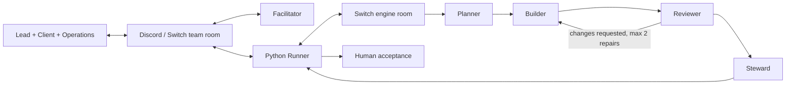

# PactRoom

**Agree together. Build automatically. Accept the exact reviewed result.**

PactRoom turns a team's conflicting requirements into a versioned agreement, then coordinates specialist coding agents through Switch and Discord. Two stakeholders must confirm the same brief before implementation begins. A changed requirement invalidates earlier confirmations and delivery evidence.

Built for **Flip the Switch — Best Business Workflow**. This is the workflow/coordinator submission repository; the generated workshop library is an example output, not the whole product. Video is being prepared and will be linked here when available.

## The problem

A client asks for automatic waitlist promotion. Operations needs manual control close to the workshop start. A coding bot can confidently build either interpretation while the team believes it agreed to something else. PactRoom preserves who owns each requirement, records agreement on a specific version, and checks delivery against that version.

## What happens

1. The delivery lead, client and operations representative discuss requirements with the facilitator in the **team room**.
2. The lead starts a task. Runner asks the planner for a structured brief with requirement IDs and acceptance examples.
3. **Both client and operations confirm the same revision and hash.** One confirmation alone does not start coding.
4. Runner dispatches the builder, executes real unittest tests, then asks the reviewer to inspect an exact-commit copy.
5. Findings return to the builder, with a maximum of two repair cycles. The steward prepares delivery details after approval.
6. The lead accepts the exact reviewed commit. A later change starts a new agreement cycle.



The arrows show Runner-controlled handoffs, not agents independently invoking each other. Switch supplies rooms, identities, message transport and agent integration; Runner supplies the agreement and delivery state machine.

## Try the code without accounts or cloud costs

Requires **Python 3.11+ and Git**. Use a short checkout path, such as `C:\src\pactroom` on Windows or `~/pactroom` on Linux. No model, token, paid service or third-party Python package is needed for these checks.

```sh
git clone https://github.com/Pranay22077/pactroom.git
cd pactroom
python -m unittest discover -s tests -v
cd examples/workshop-registration
python -m unittest discover -s tests -v
```

On Ubuntu use `python3` if `python` is unavailable. Tests exercise a simulated transport; they do not start live agents. The live worker runs on Linux because it uses a POSIX process lock. Windows supports local checks and the Switch Console client.

## What is included

| Path | Purpose |
|---|---|
| `app/` | Durable coordinator, Switch adapter, agreement state, evidence and notifications |
| `tests/` | Offline workflow, identity, stale evidence, recovery and formatting tests |
| `agent-instructions/` | Five role prompts, including a human-facing facilitator |
| `config.example.json` | Complete disabled-by-default PactRoom configuration |
| `deploy/` | Example Ubuntu systemd unit |
| `examples/workshop-registration/` | Actual accepted version-2 generated library and 18 tests |
| `docs/` | Setup, commands, architecture, evidence, limitations and provenance |

## Read next

- [Setup and deployment](docs/SETUP.md)
- [Discord commands and team roles](docs/USAGE.md)
- [Architecture and cloud boundary](docs/ARCHITECTURE.md)
- [Verification and example provenance](docs/VERIFICATION.md)
- [Operations and recovery](docs/OPERATIONS.md)
- [Security and limitations](SECURITY.md)
- [Build history and attribution](docs/BUILD_HISTORY.md)
- [Submission checklist](docs/SUBMISSION.md)

## Current boundary

The deployed pilot completed both agreement/build/review/acceptance cycles, including the cancellation change. This repository packages that implementation and a sanitized example. **Acceptance does not push, create a PR, merge or deploy.** Publishing this source repository is a separate human-authorized step. The demo library is in-memory and has no staff authentication layer.

AWS keeps the services available when laptops sleep, provided the instance, controller, model access and network remain healthy. It does not provide unlimited model usage or an availability guarantee. Shared project access is authenticated; this repository contains no live credentials, account databases or private transcripts.
