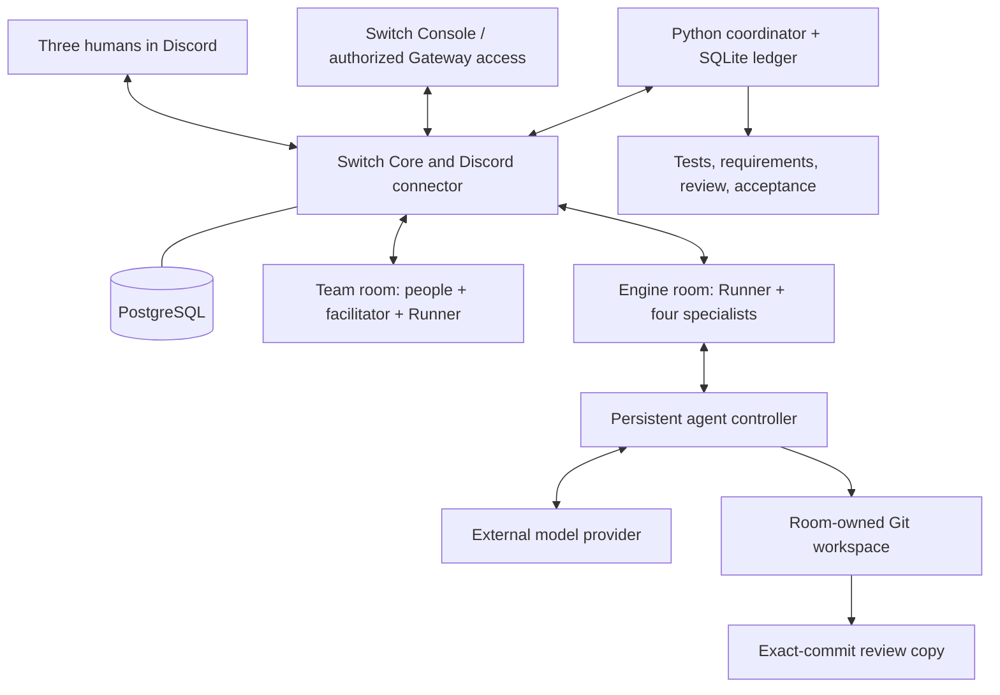

# Architecture

The laptop runs Switch Console and the browser. The qualified pilot runs Switch Core, Gateway and PostgreSQL in Docker on AWS Ubuntu. Relay Runner and the agent controller are persistent services on the same host. Codex CLI sessions call an external model provider; the EC2 instance is not hosting model weights.

Text equivalent: Discord messages enter Switch rooms. Runner validates sender and room, records durable state, and dispatches a role through Switch. The controller runs that role's CLI session. Builder writes project files on AWS; reviewer receives a separate archive of the exact commit. Runner validates results and posts short team-facing updates.

## Authoritative records

| Information | Authority |
|---|---|
| Human request | Authenticated source message |
| Requirements | Structured brief, revision and content hash |
| Stakeholder agreement | Two distinct configured senders confirming that revision/hash |
| Candidate | Full Git commit and clean working tree |
| Verification | Runner-executed unittest result plus reviewer findings |
| Acceptance | Delivery lead command bound to revision/hash/commit |

The team and engine use one room-owned project, not one project per agent. Agent home directories are launch locations; handoff workspaces are the actual task directories. Reviewer copies remain separate. A global serialized scheduler prevents concurrent autonomous writes; humans must coordinate their own edits.

## Responsibilities

- Facilitator: makes disagreement and decisions readable; cannot record agreement.
- Planner: turns a request into stable requirement IDs, owners and acceptance examples.
- Builder: implements, tests and commits; maps requirements to test names.
- Reviewer: inspects code and mappings independently at the specified commit.
- Steward: packages title/body and delivery evidence; never publishes.
- Runner: validates identity, controls sequence, tests, repair limits and state transitions.

Hashes detect changed inputs; they do not prove correctness or make the evidence tamper-proof. Prompts and separate directories do not provide OS-level isolation.
