# PactRoom: complete workflow

[Back to README](../README.md) · [Editable Mermaid source](assets/full-workflow.mmd) · [Setup](SETUP.md) · [Commands](USAGE.md)

This guide follows a request from environment setup through human agreement, implementation, independent review, acceptance and optional export. It documents the packaged implementation; it is not a fresh live-deployment verification.

## Read the diagram

- **Pale teal:** human decisions and recorded evidence.
- **Dark slate:** validation gates that control progress.
- **Dashed boxes:** waiting, rejection, operator attention or optional external actions.
- **Solid arrows:** workflow progression or setup dependencies.
- **Dotted arrows:** conditional re-entry, queries or separate operator actions.

Start at section 01 for a fresh deployment or section 02 for an existing team. The compact diagrams in the README are better for a first overview; this larger diagram is an engineering reference. Open the source in a Mermaid editor to zoom or export it. GitHub renders the diagram below.

## End-to-end flow

```mermaid
%%{init: {"theme":"base","themeVariables":{"primaryColor":"#EDF3F2","primaryTextColor":"#24383D","primaryBorderColor":"#63817F","lineColor":"#7B8D91","fontFamily":"Arial, sans-serif","fontSize":"16px"},"flowchart":{"curve":"basis","nodeSpacing":32,"rankSpacing":48}}}%%
flowchart TB
    subgraph Setup[01 · Prepare the shared environment]
        Host[Linux execution host with Git and Python] --> Docker[Switch Core, Gateway and PostgreSQL in Docker]
        Docker --> Health[Check database listener and Switch connectivity]
        Health --> Controller[Persistent agent controller and authenticated Codex CLI]
        Controller --> Profile[Five profiles with scoped role instructions]
        Profile --> Rooms[Connect separate Discord team and engine rooms]
        Rooms --> Identities[Dedicated Runner identity and three distinct human identities]
        Identities --> Config[Private configuration: rooms, senders, workspace and token path]
        Config --> Validate[Validate configuration and probe room access]
        Validate --> Worker[Enable exactly one Runner worker]
    end

    subgraph Discuss[02 · People establish the request]
        Client[Client describes product behavior] --> Facilitate[Facilitator explains conflict and decision ownership]
        Ops[Operations describes constraints] --> Facilitate
        Facilitate --> Lead[Lead sends a new pact start request]
        Lead --> Switch[Discord connector delivers team-room message through Switch]
        Switch --> Auth{Configured room, command and authorized sender?}
        Auth -->|No| Refuse[Reject request without authorizing work]
        Auth -->|Yes| Duplicate{Already handled source message?}
        Duplicate -->|Yes| Existing[Use recorded outcome; no second workflow]
        Duplicate -->|No| Task[Create task and room-owned project workspace]
    end
    Worker --> Switch

    subgraph Planning[03 · Planner produces an explicit agreement]
        Task --> Handoff[Runner persists and dispatches a targeted Planner assignment]
        Handoff --> Session[Controller runs assigned Codex session on the host]
        Session --> Brief[Structured result: objective, requirement IDs, owners and acceptance examples]
        Brief --> Schema{Valid expected result and handoff context?}
        Schema -->|No| Failure[Record failure or blocker; inspect before recovery]
        Schema -->|Yes| Version[Persist brief revision and canonical content hash]
        Version --> Decisions{Unresolved decisions remain?}
        Decisions -->|Yes| DecisionWait[WAITING_FOR_DECISION: humans resolve ambiguity]
        Decisions -->|No| ConfirmWait[WAITING_FOR_CONFIRMATION: post readable brief and exact command]
    end

    subgraph Agreement[04 · Both stakeholders confirm the current brief]
        ConfirmWait --> CConfirm[Client sends confirmation]
        ConfirmWait --> OConfirm[Operations sends confirmation]
        CConfirm --> ConfirmCheck{Current task, revision, hash and configured confirmer?}
        OConfirm --> ConfirmCheck
        ConfirmCheck -->|No| Invalid[Reject stale or unauthorized confirmation]
        ConfirmCheck -->|Yes| Record[Record confirmation with sender and source message]
        Record --> Both{Both distinct required people confirmed?}
        Both -->|No| Waiting[Keep waiting; repeated confirmation is not a second person]
        Waiting -.-> ConfirmWait
        Both -->|Yes| Queue[BUILD_QUEUED: wait for serialized scheduler]
    end

    subgraph Build[05 · Implement and test the candidate]
        Queue --> Assign[Runner dispatches Builder with task, brief, handoff and workspace]
        Assign --> Code[Builder reads project and implements on assigned task branch]
        Code --> Commit[Builder supplies candidate commit and requirement-to-test mapping]
        Commit --> Candidate{Candidate and result valid?}
        Candidate -->|No| Failure
        Candidate -->|Yes| Test[Runner executes controlled unittest command on candidate]
        Test --> Outcome{Actual test outcome?}
        Outcome -->|Pass| Archive[Prepare separate exact-commit review copy]
        Outcome -->|Supported test failure| Repair
        Outcome -->|Timeout or execution error| Failure
    end

    subgraph Review[06 · Independent review and bounded repairs]
        Archive --> ReviewAssign[Runner dispatches Reviewer with brief, candidate and test evidence]
        ReviewAssign --> Inspect[Reviewer checks behavior, code and requirement mappings]
        Inspect --> Verdict{Validated review verdict?}
        Verdict -->|Changes requested| Repair{Repair budget remains?}
        Repair -->|Yes: at most two repair cycles| Feedback[Return concrete findings to Builder]
        Feedback --> Assign
        Repair -->|No| Attention[Operator attention; no automatic retry]
        Verdict -->|Blocked or invalid result| Failure
        Verdict -->|Approved| Approved[Record approval tied to revision, hash and commit]
    end

    subgraph Delivery[07 · Package evidence and request acceptance]
        Approved --> Steward[Runner dispatches Steward to prepare delivery summary]
        Steward --> CheckDelivery[Validate delivery result and current candidate]
        CheckDelivery --> Ready[READY_FOR_ACCEPTANCE: show exact acceptance command]
        Ready --> Summary[Team sees test count, review, mapping and delivery reference]
        Summary --> AcceptCmd[Lead sends pact accept with revision, hash and commit]
        AcceptCmd --> Fresh{Authorized lead, current clean candidate and matching approved review?}
        Fresh -->|No| RejectAccept[Reject acceptance; inspect stale or changed inputs]
        Fresh -->|Yes| Accepted[ACCEPTED: persist human acceptance]
        Accepted --> Evidence[Retain detailed evidence on execution host]
    end

    subgraph Changes[08 · Changed requirements restart agreement]
        Change[Authorized requirement-change request] --> Active{Outstanding agent work?}
        Active -->|Already dispatched or uncertain| Pending[CHANGE_PENDING: settle or reconcile outstanding work]
        Active -->|No active dispatched work| Revise[Create next revision and supersede prior readiness]
        Pending --> Revise
        Revise --> Replan[Replan; old confirmations do not authorize the new brief]
        Replan --> Handoff
    end
    DecisionWait --> Change
    Summary -.->|New requirements| Change
    Accepted -.->|New requirements| Change

    subgraph Operations[09 · Recovery and inspection]
        Failure --> Attention
        Attention --> Diagnose[Inspect ledger, outstanding handoff, controller and logs]
        Diagnose --> Recovery[Use eligible operator recovery after reconciling actual state]
        Recovery -.-> Resume[Resume only the eligible recorded stage; do not blindly resend]
        Query[Configured human requests status, brief or evidence] --> Read[Read current recorded state]
        Read --> TeamReply[Post concise team-facing response]
    end

    subgraph Export[10 · Separate operator-controlled publication]
        Evidence -.-> ExportCheck[Operator verifies accepted commit and inspects export]
        ExportCheck -.-> Local[Copy source locally or prepare an authorized repository]
        Local -.-> Publish[Optional manual push or pull request]
        Publish -.-> Merge[Human-controlled merge and any later deployment]
    end

    classDef human fill:#EDF3F2,stroke:#63817F,color:#24383D,stroke-width:1.5px;
    classDef control fill:#344F54,stroke:#344F54,color:#FFFFFF,stroke-width:1.5px;
    classDef hold fill:#E6EBED,stroke:#778C93,color:#263A40,stroke-dasharray:4 3;
    classDef evidence fill:#DDEBE8,stroke:#63817F,color:#24383D;
    classDef outside fill:#FAFBFC,stroke:#9CAEB2,color:#546A70,stroke-dasharray:5 4;
    class Client,Ops,Lead,CConfirm,OConfirm,AcceptCmd,Change,Query human;
    class Auth,Duplicate,Schema,Decisions,ConfirmCheck,Both,Candidate,Outcome,Verdict,Repair,Fresh,Active control;
    class Failure,DecisionWait,ConfirmWait,Waiting,Attention,Pending,Invalid,RejectAccept,Refuse hold;
    class Version,Record,Commit,Approved,Accepted,Evidence evidence;
    class ExportCheck,Local,Publish,Merge outside;
    style Setup fill:#F8FAFB,stroke:#A1B1B4,color:#24383D;
    style Discuss fill:#F3F7F6,stroke:#A1B1B4,color:#24383D;
    style Planning fill:#F8FAFB,stroke:#A1B1B4,color:#24383D;
    style Agreement fill:#F3F7F6,stroke:#A1B1B4,color:#24383D;
    style Build fill:#F8FAFB,stroke:#A1B1B4,color:#24383D;
    style Review fill:#F3F7F6,stroke:#A1B1B4,color:#24383D;
    style Delivery fill:#F8FAFB,stroke:#A1B1B4,color:#24383D;
    style Changes fill:#F3F7F6,stroke:#A1B1B4,color:#24383D;
    style Operations fill:#F8FAFB,stroke:#A1B1B4,color:#24383D;
    style Export fill:#FAFBFC,stroke:#A1B1B4,color:#24383D,stroke-dasharray:5 4;

```

## 1. Environment and execution boundary

The tested deployment runs Switch Core, Gateway and PostgreSQL as Docker services on Ubuntu. Python Runner and the persistent agent controller are host services. Codex sessions call an external model provider; AWS does not host model weights. Console and Discord are clients.

Before enabling a new worker, verify the database listener, Core API, room access, remote executable and model authentication. A running container alone does not prove readiness. Keep private tokens and configuration outside the checkout. Only one worker should operate on a ledger. See [SETUP.md](SETUP.md).

## 2. Rooms, people and identities

The team room includes Lead, Client, Operations, Facilitator and Runner. The engine room carries assignments and specialist results. Runner is a non-model identity, not another language model.

Switch addressing permission and Runner authorization are separate checks. A message must arrive in the correct room and carry the configured sender identity. Display names, quoted mentions and model-generated approval text do not establish authority. A public Discord invitation is not automatic authorization to start or approve work.

Facilitator clarifies the disagreement. People own the actual policy choice. The delivery lead starts a task with `/pact start`; use the exact syntax in [USAGE.md](USAGE.md).

## 3. Structured planning

Runner persists a targeted assignment that identifies the task and handoff context. Planner must return a structured brief rather than just conversational prose. Each requirement has a stable ID, an owner, a rule and an acceptance example. Unresolved decisions must be explicit.

Runner validates the result and stores a canonical brief and content hash. Unresolved decisions hold the task in `WAITING_FOR_DECISION`; otherwise it enters `WAITING_FOR_CONFIRMATION`. The team sees a readable brief and the current confirmation command.

## 4. Agreement gate

Client and Operations independently confirm the exact task, revision and hash. Runner records both the person and source message. A repeated message or repeated confirmation cannot count as a second person.

One valid confirmation waits. Both current confirmations put the task in `BUILD_QUEUED`. Work starts when the serialized scheduler can dispatch it. This separation prevents the team from mistaking a queued assignment for completed implementation.

## 5. Builder and actual tests

Builder uses the workspace supplied in the assignment, not an inferred folder or its launch home. It supplies a candidate commit and a mapping from every requirement ID to test names. Empty mappings require explicit inspection evidence or a limitation; the system must not fabricate tests for non-testable criteria.

Runner checks the candidate and executes the controlled unittest test path. Actual exit status and output are evidence; an agent saying tests passed is not sufficient. Invalid paths, tool failures and uncertain execution need diagnosis rather than optimistic completion.

## 6. Independent review and repairs

Reviewer receives a separate copy of the specified commit and checks it against the same brief. Review findings cover the requirements and are associated with the candidate. A separate directory does not, by itself, enforce a security boundary or filesystem read-only permissions.

Supported test failures or review findings may return work to Builder. The configured repair budget is at most two cycles, and the implementation preserves the cumulative budget across requirement revisions. Exhaustion or a blocker requires operator attention. Do not reset counters to hide repeated failure.

## 7. Delivery and acceptance

Steward prepares the reviewed delivery summary. Runner validates the result and presents `READY_FOR_ACCEPTANCE` with the exact acceptance command.

The acceptance check requires the configured delivery lead, current revision/hash/commit, a valid current candidate and a matching approved review. A stale acceptance is rejected. Successful acceptance is recorded as `ACCEPTED`; evidence remains available on the execution host.

The team-facing summary includes tests, review, requirement mappings and acceptance. Detailed records stay outside the chat summary. Builder-supplied test references are not proof of complete coverage. Hashes detect changed inputs, not correctness or tamper resistance.

## 8. Requirement changes during and after work

A new requirement creates another brief revision. Historical confirmations remain recorded, but they do not authorize the new revision. Previous candidate readiness is superseded and current evidence must be established again.

When work has already been dispatched, a change can enter `CHANGE_PENDING`. Runner must settle or reconcile outstanding work before continuing with the next revision. It must not dispatch conflicting work simply because a new message arrived. Both stakeholders confirm the revised brief before the next implementation.

## 9. Recovery and observability

Configured humans can request `/pact status`, `/pact brief` and `/pact evidence` without manually invoking each specialist. Runner is a command processor; general questions belong with Facilitator.

On a blocker, inspect the persisted task, handoff, actual agent session and service logs. A timed-out or uncertain assignment must not be blindly resent. Recovery tools have eligibility checks: an explicitly completed blocked Builder report is different from work whose outcome is unknown. See [OPERATIONS.md](OPERATIONS.md) before performing recovery.

## 10. Export and publication are separate

Acceptance does not push, create a pull request, merge or deploy. The dotted final branch represents optional operator work, not implemented automatic publication.

An operator verifies the accepted commit, inspects an export for secrets and runtime metadata, and then copies it locally or prepares an authorized GitHub repository. A source archive does not include Git history. Record its provenance. Any merge or application deployment remains a separate human-controlled action.

## Example: the workshop policy

| Input | Agreed outcome |
|---|---|
| Ada and Ben confirmed; Chen waiting; Ada cancels more than 120 minutes before start | Chen is promoted automatically |
| Same queue; Ada cancels exactly 120 minutes before start | Vacancy waits for explicit staff promotion |
| Dia arrives while that vacancy is pending | Dia cannot bypass Chen |
| A mutation is attempted at or after event start | Reject the mutation |

The accepted version-2 example includes 18 application tests. It is an in-memory library with no staff authentication layer. These are historical pilot/example facts, not a fresh cloud run performed for this diagram. See [VERIFICATION.md](VERIFICATION.md).

## Implementation references

| Concern | Reference |
|---|---|
| Agreement, revision changes, confirmations and acceptance | [app/pact.py](../app/pact.py) |
| Coordinator and transport implementation | [app/](../app/) |
| Role instructions | [agent-instructions/](../agent-instructions/) |
| Disabled configuration template | [config.example.json](../config.example.json) |
| Service configuration | [deploy/](../deploy/) |
| Test coverage and failure cases | [tests/](../tests/) |
| Generated example | [examples/workshop-registration/](../examples/workshop-registration/) |

[Return to the project README](../README.md)
